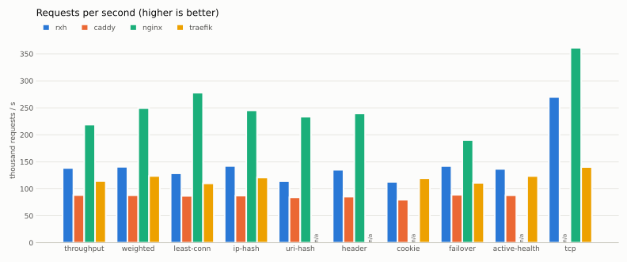

# RXH: reverse proxy and load balancer for HTTP/1, HTTP/2, HTTP/3, TCP and UDP

[](https://github.com/LOSEARDES77/rxh/actions/workflows/ci.yml)
[](LICENSE)
[](https://www.rust-lang.org)

**RXH** is a fast, lightweight **reverse proxy** and **load balancer** written
in Rust. It balances **HTTP/1.1, HTTP/2, HTTP/3 (QUIC) and WebSocket**
traffic (layer 7) and **any TCP or UDP protocol** (layer 4): databases,
Redis, MQTT, gRPC, game servers, DNS. It runs as a **daemon** that you manage
from a **CLI**, the **admin API** or a **web dashboard**: add or remove
backends from a load balancing pool while it runs, without dropping a
connection. It gets certificates from Let's Encrypt by itself, and finds its
backends in Docker, Kubernetes, Consul, etcd or Nomad.

RXH implements every load balancing policy, retry option and health check of
[Caddy](https://caddyserver.com)'s `reverse_proxy`, and adds TCP/UDP
balancing, named pools and live pool management on top. See
[PARITY.md](PARITY.md) for the feature by feature comparison, and
[`rxh-bench`](crates/bench/README.md) to measure both side by side.

```console
$ rxh service add --listen 0.0.0.0:80 --to @web --name web
Added service to /etc/rxh/rxh.toml
Daemon reloaded
$ rxh upstream add web 10.0.0.12:8080
Saved 10.0.0.12:8080 to pool web in /etc/rxh/rxh.toml
Added 10.0.0.12:8080 to pool web on the running daemon
$ rxh status
pool web (least_conn)
  ADDRESS                      WEIGHT    STATE  ACTIVE  REQUESTS FAILS
  10.0.0.11:8080                    1      yes      12     48210     0
  10.0.0.12:8080                    1      yes       9        97     0
```

## Features

- **Layer 7 and layer 4.** HTTP reverse proxy, raw TCP proxy (with optional
  TLS termination and PROXY protocol v1/v2) and UDP proxy with per client
  sessions, all from one binary.
- **HTTP/3 over QUIC**, on by default on every `http` server with `tls`, on
  the UDP port next to HTTP/1.1 and HTTP/2, announced with `Alt-Svc`
  (`http3 = false` turns it off).
- **Layer 4 routing**: `tcp` servers route by TLS SNI and ALPN (TLS
  passthrough), detected protocol (`tls`, `http`, `ssh`, PostgreSQL), HTTP
  `Host`, `remote_ip` and `regexp`, with subroutes, and
  `http` and `tcp` servers accept an incoming PROXY v1/v2 header
  (`proxy_protocol_in`) from `trusted_proxies` and send one to their backends
  (`proxy_protocol`).
- **Virtual hosts and request matchers**: several `http` servers share one
  address, picked by `host` (exact or `*.wildcard`), with TLS certificates
  chosen by SNI. Routes match on `host`, `path` patterns, `method`, `header`,
  `query` and `remote_ip`.
- **Upstreams over HTTPS, unix sockets and DNS**: `https://` backends with
  `server_name`, custom CAs and client certificates, `unix//` sockets, and
  pools filled from DNS `A`/`AAAA` or `SRV` records that refresh while
  running.
- **12 load balancing policies**, the same as Caddy: `random`,
  `random_choose`, `first`, `round_robin`, `weighted_round_robin` (smooth),
  `least_conn`, `ip_hash`, `client_ip_hash`, `uri_hash`, `query`, `header`,
  and `cookie` sticky sessions. Hash policies use rendezvous hashing, so
  adding a backend only moves the keys it takes over, or a Maglev table
  (`hash_type = "maglev"`), with optional bounded loads
  (`hash_balance_factor`).
- **Health checks.** Active HTTP, gRPC or TCP connect checks (path, port,
  method, headers, status, body regex), plus passive checks on real traffic
  (failed dials, 5xx, slow responses, concurrency limits), with hooks and
  webhooks on health events.
- **Traffic management**: weighted pools for canary releases and traffic
  splitting, request mirroring, circuit breakers on error ratio or latency,
  slow start, per backend connection limits with a queue, and drain and
  maintenance states (`rxh upstream drain`).
- **Retries and failover**: `retries`, `try_duration`, `try_interval`,
  retry budgets (`retry_budget`) and hedged requests (`hedge_delay`).
  Failed dials and stale keep-alive connections move to another backend, and
  `GET` requests are retried after a failed round trip. `retry_match`
  chooses the retried methods and the response statuses that move a request
  to another backend.
- **Timeouts**: upstream `dial_timeout`, `response_header_timeout`,
  `read_timeout` and `write_timeout`; listener `read_header_timeout` (also
  bounding TLS handshakes and silent clients), `idle_timeout` and
  `stream_timeout`.
- **Observability**: Prometheus `/metrics` on the admin API (requests,
  latency histogram, layer 4 connections, per upstream counters and health),
  OpenTelemetry tracing with W3C trace context, text or JSON access logs to
  stdout, stderr or a file with filters and sampling, and `rxh top`.
- **Service discovery**: routes to Docker, Docker Swarm and Podman
  containers from their `rxh.*` labels, to Consul, etcd and Nomad services,
  and from Kubernetes Ingress and Gateway API resources, followed live.
- **Security**: mutual TLS, TLS versions, ciphers and curves, OCSP stapling,
  `ip_allow`/`ip_deny`, `rate_limit`, `max_connections_per_ip`,
  `basic_auth`, `forward_auth` (Authelia, Authentik, oauth2-proxy), CORS
  and security header presets.
- **Daemon and CLI**: `rxh start | stop | reload | status`, and
  `rxh upstream | pool | service` to manage peers, pools and listeners. The
  CLI edits the TOML file without losing your comments, validates it, then
  applies the change live. `include` globs split the configuration over
  several files, and `rxh config show` prints the merged result.
- **Quick commands**: `rxh file-server` and `rxh reverse-proxy` serve a
  directory or proxy to backends right away, without a configuration file.
- **Zero downtime reloads** (`SO_REUSEPORT`). An invalid configuration is
  rejected and the running one keeps serving. `watch = true` reloads when a
  file changes, and `{env.NAME}` and `{file.PATH}` placeholders keep secrets
  out of the file.
- **Hot binary upgrades** on Linux: `rxh upgrade` starts the new binary and
  hands it the listening sockets, without refusing a connection.
- **Admin API** on `127.0.0.1:2019` (JSON), with Caddy compatible
  `/reverse_proxy/upstreams`, optional HTTPS, and a web dashboard with
  accounts: first-run setup, roles with View, Modify, Create and Delete on
  groups of hosts, sign-in through an OpenID Connect provider, and
  `rxh user` for the way back in.
- **HTTP done right**: keep-alive pools to backends, h2/h2c, WebSocket
  tunnels, hop-by-hop header stripping, `X-Forwarded-*` with
  `trusted_proxies`, RFC 7239 `Forwarded`, `Via`, header rules (`set`, `add`,
  wildcard `remove`, regex `replace`), on the fly `zstd`/`br`/`gzip`
  compression (`encode`), a response cache, gRPC-Web and custom error
  pages.
- **File server**: streamed files with range requests, `ETag` and
  `Last-Modified` conditional requests, precompressed `.zst`/`.br`/`.gz`
  files, `index` files, `hide` patterns and an optional directory listing.
- **Automatic HTTPS**: `tls = "auto"` obtains and renews certificates from
  Let's Encrypt (or any ACME CA) with HTTP-01, TLS-ALPN-01 or DNS-01
  (wildcards; Cloudflare, Route 53, RFC 2136), swapped in without a restart,
  and redirects HTTP to HTTPS.
- **Rewrites and redirects**: `rewrite` and `request.method` change the
  request a route forwards or serves, `redirect` answers `301`/`302`/`308`
  with `{host}`, `{path}`, `{query}` and `{uri}` placeholders.
- **Deployment**: official images, static musl binaries and packages,
  systemd readiness and socket activation, shell completions and man pages.
- **Also**: one runtime per core (`runtime = "per_core"`), `splice` zero
  copy for TCP on Linux, connection limits, graceful shutdown with
  `grace_period`.

## Benchmarks

`rxh-bench` starts the same backends behind rxh, Caddy, NGINX and Traefik,
runs every scenario on each and checks that each policy does what it
promises. With every proxy in Docker (32 keep-alive connections, AMD Ryzen 9
7950X), rxh serves about twice the requests of Caddy, is 35% to 45% faster
than Traefik over HTTP, and reaches about 70% of the throughput of NGINX
over HTTP/1.1, level with it over HTTP/2 and UDP. It is the only one of the
four that runs and passes all seventeen scenarios: every policy, failover,
TCP, TLS, HTTP/2, WebSocket, UDP, large bodies and idle connections.



Tables, latency and the limits of the measurement are in
[docs/benchmarks.md](docs/benchmarks.md). Where the time of a request goes is
in [docs/profiling.md](docs/profiling.md). Run it yourself:

```bash
cargo build --release -p rxh-cli -p rxh-bench
./target/release/rxh-bench --docker          # all four proxies in Docker
./target/release/rxh-bench --quick --caddy "$(which caddy)"   # rxh and a native Caddy
```

## Install

From source, with Rust 1.100 or newer:

```bash
cargo install --git https://github.com/LOSEARDES77/rxh rxh-cli   # installs `rxh`
```

Or build the repository:

```bash
git clone https://github.com/LOSEARDES77/rxh && cd rxh
cargo build --release        # binary at target/release/rxh
```

Or run the official image (amd64 and arm64; `alpine` and `distroless`
variants too, see [Running in a container](docs/configuration.md#running-in-a-container)):

```bash
docker run -p 80:80 -v "$PWD/rxh.toml:/etc/rxh/rxh.toml:ro" ghcr.io/loseardes77/rxh
```

Or install a release package: static musl binaries, `.deb`, `.rpm`, the
`rxh-bin` AUR package and a Homebrew formula are published on every release
(see [Installing a release package](docs/configuration.md#installing-a-release-package)).

Docker, systemd and packaging files are in [`dist/`](dist).

## Quick start

1. Write a configuration, for example `rxh.toml`:

   ```toml
   [upstream.web]
   policy = "least_conn"
   backends = ["127.0.0.1:3001", "127.0.0.1:3002"]
   health = { uri = "/health", interval = "5s" }
   passive = { fail_duration = "30s", unhealthy_status = ["5xx"] }

   [[server]]
   listen = "0.0.0.0:8080"
   forward = "@web"

   [[server]]
   listen = "0.0.0.0:6379"
   protocol = "tcp"
   forward = { policy = "first", backends = ["10.0.0.1:6379", "10.0.0.2:6379"] }
   ```

2. Run it in the foreground, or as a daemon:

   ```bash
   rxh run -c rxh.toml        # foreground
   rxh start -c rxh.toml      # background, PID file in /tmp/rxh/rxh.pid
   ```

3. Manage it while it runs:

   ```bash
   rxh status                                   # listeners, pools, health
   rxh upstream add web 127.0.0.1:3003 -w 2     # add a peer (live + saved)
   rxh upstream rm web 127.0.0.1:3001           # drain a peer
   rxh pool add db --policy first -b 10.0.0.1:5432 -b 10.0.0.2:5432 --health-interval 5s
   rxh service add --listen 0.0.0.0:5432 --protocol tcp --to @db --name postgres
   rxh reload                                   # after editing the file by hand
   rxh stop
   ```

### Quick file server and proxy

No configuration file needed, like `caddy file-server` and `caddy reverse-proxy`:

```bash
rxh file-server                                   # serve . on http://127.0.0.1:8080
rxh file-server --root ./public --listen 0.0.0.0:8000 --no-browse --encode
rxh reverse-proxy --from 127.0.0.1:8080 --to 127.0.0.1:3001 127.0.0.1:3002 --policy round_robin
```

Split big setups with `include = ["conf.d/*.toml"]`, see
[`examples/includes`](examples/includes) and the [reference](docs/configuration.md#includes).

More configurations: [`examples/`](examples), including
[every option](examples/full.toml), an
[HTTP load balancer with sticky sessions](examples/http-load-balancer.toml)
and [TCP/UDP balancing](examples/tcp-udp.toml). The full reference is in
[docs/configuration.md](docs/configuration.md).

Step by step guides, one per use case, are on the
[documentation site](docs/README.md): an
[HTTP load balancer](docs/guides/load-balancer.md), a
[TLS gateway](docs/guides/tls-gateway.md), [Docker](docs/guides/docker.md)
and [layer 4 (TCP and UDP)](docs/guides/layer4.md).

## CLI

| Command | What it does |
|---|---|
| `rxh run` | Run in the foreground (default command). |
| `rxh start` / `stop` / `reload` | Daemon control through the admin API, with PID file and signal fallbacks. |
| `rxh upgrade` | Replace the daemon with the binary now on disk; the new process takes over the listening sockets (Linux). |
| `rxh status [--json]` | Listeners, pools, health and request counters. |
| `rxh top [-i 1s] [-n N]` | Live requests per second, errors, latency and health per pool, from `/metrics`. |
| `rxh validate` | Check a configuration file. |
| `rxh fmt [--check] [FILE...]` | Rewrite configuration files in one layout, keeping comments. |
| `rxh schema` | Print the JSON schema of the configuration file, for completion in editors. |
| `rxh adapt FILE` | Convert a Caddyfile or an nginx configuration into RXH TOML. |
| `rxh upstream list\|add\|rm` | Manage the backends (peers) of a pool, live and in the file. `--no-save` changes only the running daemon. |
| `rxh upstream drain\|maintenance\|ready` | Take a backend out of rotation, letting requests in flight (and, with `drain`, sticky sessions) finish, then put it back. |
| `rxh pool list\|add\|rm` | Manage `[upstream.NAME]` pools (`--file` writes to an included file). |
| `rxh service list\|add\|rm` | Manage `[[server]]` listeners (HTTP, TCP, UDP, files). |
| `rxh config show [--json]` | Effective configuration, includes merged. |
| `rxh file-server`, `rxh reverse-proxy` | Serve a directory or proxy to backends without a configuration file. |
| `rxh cert list [--json]` | Certificates of every TLS listener, with expiry dates. |
| `rxh cert reload` | Read the certificate files again now (the daemon also does it within seconds of a change). |
| `rxh policies` | List load balancing policies. |
| `rxh hash-password` | Hash the password read from standard input, for `basic_auth` users. |
| `rxh completions SHELL`, `rxh man` | Shell completion scripts and man pages. |
| `rxh user list\|add\|passwd\|rm` | Manage admin API accounts in `[admin] users`, with or without a daemon: the way back in when every password is lost. |

Global flags: `-c/--config` (`RXH_CONFIG`), `--admin` (`RXH_ADMIN`),
`--pid-file`.

## Admin API

JSON over HTTP on `[admin] listen`: a TCP address (default `127.0.0.1:2019`)
or a unix socket (`unix//run/rxh/admin.sock`), and HTTPS on the same port
with `[admin] tls = { cert, key }`. Without `[admin] token`, a request from
the machine itself (by the address of its connection, with a loopback
`Host` and no foreign `Origin`) is an administrator, as the CLI is. Anybody
else sends `Authorization: Bearer <token>`, or signs in with an account of
`[admin] users`: roles grant View, Modify, Create and Delete on groups of
hosts (`groups` on a `[[server]]`), and the first administrator is created
on first use. People can also sign in through one OpenID Connect provider
(`[admin.oidc]`), whose groups give them roles. A reachable `listen` needs
`token` or `tls`. See [Accounts](docs/configuration.md#accounts) and
[OpenID Connect](docs/configuration.md#openid-connect).

| Method | Path | Action |
|---|---|---|
| `GET` | `/status` | Version, uptime, listeners, pools |
| `GET` | `/config` | Running configuration with live pool members |
| `GET` | `/pools`, `/pools/{name}` | Members, health, in-flight and total requests |
| `GET` | `/reverse_proxy/upstreams` | Caddy compatible upstream list |
| `POST` | `/pools/{name}/upstreams` | Add `{"address": "host:port", "weight": 1}` |
| `DELETE` | `/pools/{name}/upstreams` | Remove `{"address": "host:port"}` |
| `GET` | `/metrics` | Prometheus metrics (text format 0.0.4) |
| `GET` | `/certificates` | Certificates served, with expiry dates |
| `GET` | `/dashboard` | Web UI: statistics of the last hour, hosts, pools, certificates and settings, with forms that save to the configuration file, sign-in and a Users tab. Served without the token, with `/dashboard/app.js` and `/dashboard/app.css` |
| `GET` | `/schema` | JSON schema of the configuration |
| `GET` | `/stats/history` | One hour of counters, one sample every 5 seconds |
| `GET` | `/config/files` | Configuration files and their tables, secrets as `***` |
| `PUT` | `/config/files/{index}` | Save the text of one file, validate, reload |
| `POST` | `/config/entities/{kind}` | Add a `server`, `upstream` or `section` to a file |
| `PUT`, `DELETE` | `/config/entities/{kind}/{key}` | Save or delete one of them; the file is put back when the change is not valid or does not reload |
| `POST` | `/certificates/reload` | Read the certificate files again |
| `POST` | `/reload` | Reload the configuration file |
| `POST` | `/load` | Run the configuration in the body (TOML or JSON), without writing the file |
| `PATCH` | `/config/upstream/{name}` | Merge the body into one pool |
| `PATCH` | `/config/server/{name or index}` | Merge the body into one server |
| `POST` | `/upgrade` | Hand the listening sockets to a new process running the binary on disk (Linux) |
| `POST` | `/stop` | Graceful shutdown |
| `GET` | `/auth/session` | Who the caller is |
| `POST` | `/auth/login`, `/auth/logout`, `/auth/setup` | Sign in and out (session cookie), create the first user |
| `GET` | `/auth/oidc/login`, `/auth/oidc/callback` | Sign in through the OpenID Connect provider of `[admin.oidc]` |
| `PUT` | `/auth/password` | Change one's own password |
| `GET`, `POST`, `PUT`, `DELETE` | `/users`, `/users/{name}`, `/roles`, `/roles/{name}` | Accounts and roles, for administrators |

```bash
curl -s localhost:2019/pools/web | jq
curl -s -X POST localhost:2019/pools/web/upstreams -d '{"address":"10.0.0.13:8080"}'
curl -s -X POST localhost:2019/load --data-binary @new.toml
curl -s -X PATCH localhost:2019/config/upstream/web -d '{"policy":"least_conn"}'
```

`http://127.0.0.1:2019/dashboard` is the web UI over these routes; see
[Dashboard](docs/configuration.md#dashboard) and
[Editing from the dashboard](docs/configuration.md#editing-from-the-dashboard).

## Project layout

RXH is a Cargo workspace:

| Crate | Role |
|---|---|
| [`crates/core`](crates/core) (`rxh-core`) | Configuration model and the load balancing engine: policies, pools, health state. No I/O. |
| [`crates/server`](crates/server) (`rxh-server`) | Runtime on Tokio and Hyper: listeners, HTTP proxy, TCP/UDP proxy, health checks, admin API, daemon. |
| [`crates/cli`](crates/cli) (`rxh-cli`) | The `rxh` binary: daemon and CLI. |
| [`crates/bench`](crates/bench) (`rxh-bench`) | Correctness and performance comparison against Caddy, NGINX and Traefik. |

## Development

```bash
cargo fmt --all
cargo clippy --workspace --all-targets
cargo test --workspace
./target/release/rxh-bench --quick --no-caddy   # smoke test of every policy
```

Dependencies are checked with `cargo audit` and `cargo deny check` (policy in
[deny.toml](deny.toml)). Report vulnerabilities as described in
[SECURITY.md](SECURITY.md).

Fuzz targets for the parsers live in [`fuzz/`](fuzz); see
[docs/fuzzing.md](docs/fuzzing.md) for how to run them with `cargo fuzz`.

Feature progress against Caddy is tracked in [PARITY.md](PARITY.md). The plan
for the next versions is in [ROADMAP.md](ROADMAP.md).

## License

[MIT](LICENSE). RXH started as a learning project by
[Antonio Sarosi](https://github.com/antoniosarosi/rxh).
