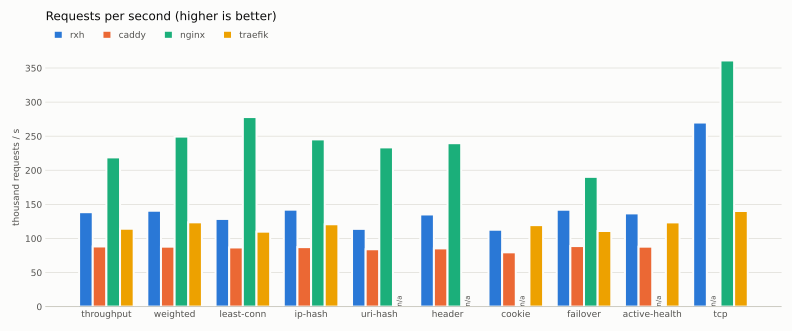
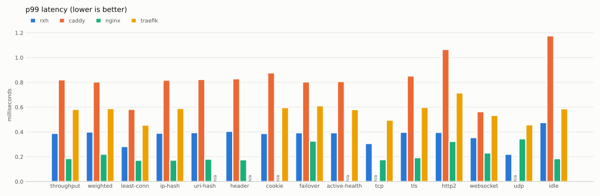

# Benchmarks

RXH against Caddy, NGINX and Traefik, measured with
[`rxh-bench`](../crates/bench/README.md). Every proxy runs in Docker with
host networking, in front of the same backends, with the same load.

Measured 2026-11-18 on an Intel Core Ultra 7 255H (16 threads), Linux 7.3.
Each scenario runs for 5 seconds with 32 keep-alive connections.

| Proxy | Image |
|---|---|
| rxh 0.2.0 | release binary mounted into `debian:stable-slim` |
| Caddy 2 | `caddy:2` |
| NGINX (open source) | `nginx:stable-alpine` |
| Traefik 3.7 | `traefik:v3` |

## Results





Requests per second:

| Scenario | rxh | Caddy | NGINX | Traefik |
|---|---:|---:|---:|---:|
| throughput | 138 548 | 88 232 | 218 945 | 114 217 |
| weighted | 140 674 | 87 920 | 249 433 | 123 621 |
| least-conn | 128 661 | 86 823 | 278 087 | 109 913 |
| ip-hash | 142 265 | 87 235 | 245 292 | 120 854 |
| uri-hash | 114 083 | 84 189 | 233 607 | n/a |
| header | 135 184 | 85 445 | 239 717 | n/a |
| cookie | 112 793 | 79 696 | n/a | 119 561 |
| failover | 142 170 | 88 806 | 190 324 | 110 918 |
| active-health | 136 747 | 87 950 | n/a | 123 563 |
| tcp | 270 016 | n/a | 361 123 | 140 306 |

p99 latency in milliseconds:

| Scenario | rxh | Caddy | NGINX | Traefik |
|---|---:|---:|---:|---:|
| throughput | 0.64 | 1.32 | 0.46 | 0.97 |
| weighted | 0.62 | 1.34 | 0.41 | 0.92 |
| least-conn | 0.52 | 1.04 | 0.28 | 0.72 |
| ip-hash | 0.61 | 1.33 | 0.42 | 0.94 |
| uri-hash | 0.91 | 1.40 | 0.44 | n/a |
| header | 0.65 | 1.33 | 0.43 | n/a |
| cookie | 0.76 | 1.43 | n/a | 0.94 |
| failover | 0.61 | 1.31 | 0.66 | 1.06 |
| active-health | 0.67 | 1.31 | n/a | 0.90 |
| tcp | 0.32 | n/a | 0.31 | 1.31 |

The full report, with the verdict and the share of requests per backend for
each run, is in [bench/results.md](bench/results.md). The raw data is in
[bench/results.json](bench/results.json).

## More scenarios: TLS, HTTP/2, bodies, WebSocket, UDP, idle connections

Measured 2026-11-19 on the same machine, with rxh 0.3.0 (unreleased) and
the same images: 5 seconds per scenario, 32 connections, 5000 idle
connections for `idle` and `memory`. The scenarios are described in the
[rxh-bench README](../crates/bench/README.md#scenarios).

Requests (or echo round trips) per second, and p99 latency in milliseconds:

| Scenario | rxh | Caddy | NGINX | Traefik |
|---|---:|---:|---:|---:|
| tls | 190 136 / 0.49 | 100 248 / 0.84 | 288 884 / 0.22 | 150 499 / 0.60 |
| http2 | 151 601 / 0.42 | 76 200 / 1.07 | 167 035 / 0.28 | 111 044 / 0.69 |
| large-body (1 MiB each way) | 1 999 / 25.83 | 2 649 / 19.93 | 1 096 / 49.10 | 2 648 / 19.59 (FAIL) |
| websocket | 258 879 / 0.34 | 181 093 / 0.57 | 311 340 / 0.25 | 185 572 / 0.56 |
| udp | 247 093 / 0.21 | n/a | 233 041 / 0.35 | 199 523 / 0.45 |
| idle (load next to 5000 idle connections) | 193 355 / 0.52 | 125 458 / 1.12 | 320 431 / 0.22 | 151 221 / 0.60 |

Memory per idle keep-alive connection (RSS growth over 5000 connections,
after 100 warm-up connections):

| | rxh | Caddy | NGINX | Traefik |
|---|---:|---:|---:|---:|
| Per connection | 27.7 KiB | 30.2 KiB | 0.6 KiB | 35.3 KiB |
| RSS with 100 connections | 14.5 MiB | 65.5 MiB | 234.3 MiB | 112.4 MiB |
| RSS with 5100 connections | 150.0 MiB | 212.8 MiB | 237.2 MiB | 284.5 MiB |

NGINX's RSS is summed over its master and one worker per core (16 here),
which is why it starts high; its per connection cost is the lowest by far.

- **rxh passes all seven.** Traefik failed `large-body` in two runs out of
  two: about one response body in a thousand was cut off mid-stream (6 or 7
  of ~6 600). The same backends and client pass through the three other
  proxies.
- **rxh is slower with large bodies**: 2.0 GB/s each way against 2.6 for
  Caddy and Traefik. NGINX buffers request bodies to disk by default and
  comes last.
- **HTTP/2 narrows the gap with NGINX** (0.91x) compared with HTTP/1.1 over
  TLS (0.66x). rxh leads on UDP.
- **Memory**: rxh starts the smallest and holds an idle connection in
  slightly less than Caddy and Traefik, but about 45 times more than NGINX.
  Idle buffers per connection are a target for the performance milestone.

## What the numbers say

- **Correctness**: every scenario a proxy can run passes. No run failed.
- **rxh and Caddy**: rxh serves about 1.5 times the requests of Caddy, with
  about half the p99 latency.
- **rxh and Traefik**: rxh is 10% to 30% faster over HTTP and almost twice
  as fast over TCP. Traefik wins the `cookie` scenario by 6%.
- **rxh and NGINX**: NGINX is the fastest. It serves 1.3 to 2.2 times the
  requests of rxh. Closing this gap is the performance milestone of the
  [roadmap](../ROADMAP.md).
- **Coverage**: rxh is the only proxy of the four that runs all ten
  scenarios. Open source NGINX has no sticky cookies and no active health
  checks. Traefik hashes only the client IP. Core Caddy has no layer 4
  proxy.

## Limits of this benchmark

- The backends and the load generator run in the same process as the
  benchmark, on the same machine as the proxies. They compete for the same
  cores. Read the ratios, not the absolute values.
- One run per scenario. Differences below 10% are noise; one earlier run
  was off by half and went back to normal when repeated.
- In the first table, requests are small `GET`s over cleartext HTTP/1.1.
  TLS, HTTP/2, large bodies, WebSocket, UDP and idle connections are in
  their own section. TLS clients keep their connection, so handshakes are
  not measured.
- Traefik's `least-conn` uses `p2c`, and NGINX's `ip-hash` uses
  `hash $remote_addr consistent`. See the
  [mapping table](../crates/bench/README.md#nginx-and-traefik).
- Proxies run with their defaults, apart from upstream keep-alive,
  `worker_processes auto`, `client_max_body_size 0` and
  `keepalive_requests 1000000` on NGINX, and rxh's `max_connections`
  raised above the 5000 idle connections.

## History across releases

Every release is measured with `rxh-bench --docker` on the same machine, and
the raw JSON is kept in [bench/history](bench/history/README.md), one
`<version>.json` per release next to a `<version>.md` with the machine, the
commit and the full report. The history page shows rxh's requests per second
and p99 latency for every scenario and release, and marks in bold every
change of more than 10% for the worse against the previous release (single
runs differ by up to 10%).

To add a release, check out its tag on the benchmark machine and run:

```bash
crates/bench/release.sh            # version from Cargo.toml, or pass it: release.sh 0.3.0
```

The script builds the release binaries, runs `rxh-bench --docker`, writes
`docs/bench/history/<version>.json` and `<version>.md`, regenerates
`docs/bench/history/README.md` with `rxh-bench --history docs/bench/history`
and prints the regressions. It refuses to replace an existing version unless
`FORCE=1`, warns when `HEAD` is not tagged `v<version>` or the tree has
uncommitted changes, and exits with 1 when rxh fails a scenario (the results
are kept). Extra arguments go to `rxh-bench`, for example `-s throughput`.
Commit the three files.

Numbers from different machines are not comparable: the history lists the
CPU of every release and warns when they differ. The 0.2.0 entry is the run
above.

## Policy micro benchmarks

`crates/core/benches/policies.rs` measures `Pool::select`, the backend choice
made for every request, with [Criterion](https://docs.rs/criterion) for every
policy, with 4 and 64 healthy backends. The request carries every key a
policy reads (IPs, path, query, header), and `cookie` sends back the cookie
of a first selection, so it measures the sticky path.

```bash
cargo bench -p rxh-core --bench policies
cargo bench -p rxh-core --bench policies -- cookie   # one policy
```

`cargo test` runs each benchmark once without timing, which checks that every
policy picks a backend and that a valid cookie keeps its backend.

Median time per selection, 0.3.0 on an AMD Ryzen 9 7950X (one thread):

| Policy | 4 backends | 64 backends |
|---|---:|---:|
| `random` | 20 ns | 138 ns |
| `random_choose` | 31 ns | 207 ns |
| `first` | 16 ns | 16 ns |
| `round_robin` | 18 ns | 18 ns |
| `weighted_round_robin` | 19 ns | 20 ns |
| `least_conn` | 18 ns | 139 ns |
| `ip_hash` | 93 ns | 232 ns |
| `client_ip_hash` | 92 ns | 233 ns |
| `uri_hash` | 42 ns | 181 ns |
| `query` | 33 ns | 170 ns |
| `header` | 40 ns | 178 ns |
| `cookie` | 38 ns | 57 ns |

The rotating policies and `first` cost the same at any size. The others look
at every member, so they grow with the pool: `random` draws a random number
per member (reservoir sampling), and `ip_hash` and `client_ip_hash` also
format the IP as a string before hashing. Even the slowest, a hash over 64
backends, stays far below the microseconds of a proxied request.

## Run it yourself

```bash
cargo build --release -p rxh-cli -p rxh-bench
./target/release/rxh-bench --docker --json docs/bench/results.json > docs/bench/results.md
python3 crates/bench/plot.py docs/bench/results.json docs/bench   # needs matplotlib
```
