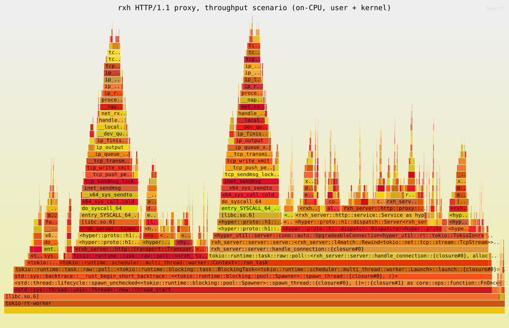
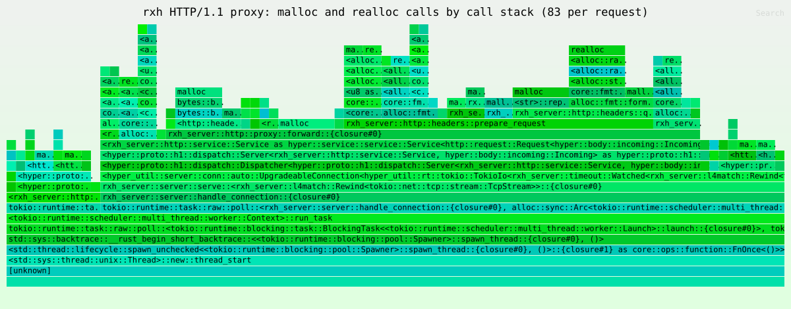

# Profiling the HTTP hot path

Where RXH spends CPU time and memory allocations when it proxies a small
HTTP/1.1 request, measured before any optimisation of the
[0.4 milestone](../ROADMAP.md). No runtime code was changed for this work.

Measured 2026-11-18 at commit `def4bc6` (0.3.0, unreleased) on an AMD Ryzen 9
7950X (16 cores, 32 threads), Linux 7.3, glibc 2.44, rustc 1.100.0.

## Summary

| # | Finding | Evidence |
|---|---|---|
| 1 | The CPU cost of a request triples when RXH goes from 1 worker thread to 32: 14 µs to 41 µs. | [Scaling](#scaling-with-worker-threads) |
| 2 | A proxied request makes 84 allocator calls (66 `malloc`, 17 `realloc`, 1 `posix_memalign`) and 67 `free` calls. 66 of them come from RXH code, 33 from building the forwarding headers. | [Allocations](#allocations-per-request) |
| 3 | The access log is on by default and costs 13% of the CPU of a request: one `write` system call per request, under a lock. The benchmark runs NGINX with `access_log off`. | [Access log](#access-log) |
| 4 | String formatting (`format!`, `to_string`) is 7% of the CPU. | [CPU profile](#cpu-profile) |
| 5 | Every request spawns a task to put the upstream connection back in the idle pool: 2.8% of the CPU and a mutex shared by all workers. | [CPU profile](#cpu-profile) |
| 6 | 43% of the CPU is kernel time, mostly TCP send. RXH already makes the minimum of 2 `sendto` and 2 `recvfrom` calls per request. | [System calls](#system-calls-per-request) |
| 7 | Route matching, upstream selection and metrics are not hot. | [CPU profile](#cpu-profile) |

What this means for the roadmap is in [Recommendations](#recommendations).

## Method

The workload is the `throughput` scenario of
[`rxh-bench`](../crates/bench/README.md): `GET` requests over 32 keep-alive
connections, `round_robin` over 4 backends, cleartext HTTP/1.1. The load
generator and the backends run in the `rxh-bench` process on the same machine.
RXH runs natively, not in Docker.

The binary is the release profile with debug information and frame pointers.
It runs as fast as the plain release binary (229 049 and 229 711 requests per
second).

| Question | Tool |
|---|---|
| Where does CPU time go? | `perf record -F 999 -g` on the RXH process for 15 seconds, user and kernel stacks |
| How many allocations? | uprobes on `malloc`, `calloc`, `realloc`, `free`, `posix_memalign`, `memalign` and `aligned_alloc` of glibc, counted with `perf stat` |
| How many per request? | a uprobe on `rxh_server::http::headers::prepare_request`, which runs once per proxied request, counted in the same `perf stat` |
| Who allocates? | `perf record -g` on the `malloc` and `realloc` probes, folded by call stack |
| How many system calls? | `perf stat -e 'syscalls:sys_enter_*'` |
| How much CPU per request? | user and system time of the process from `/proc/PID/stat` over 10 seconds, divided by the requests served |

The exact commands are in [Reproduce](#reproduce).

## Baseline

| Metric | Value |
|---|---:|
| Requests per second | 229 000 |
| p99 latency | 0.39 ms |
| CPU used by RXH | 9.3 cores (6.2 user, 3.1 system) |
| CPU per request | 40.6 µs |
| Worker threads | 32 |

The load is closed loop: each of the 32 connections waits for its response
before it sends the next request. RXH is not CPU bound here. It uses 9 of 32
CPUs, and the request rate is set by the latency of one request. This is why
saving CPU does not always raise the request rate in this scenario.

## CPU profile



[profiling/cpu.svg](profiling/cpu.svg) is interactive when opened directly in
a browser. Frames are physical functions: inlined functions are counted in
their caller.

Every sample belongs to exactly one bucket in this table. The second column
converts the share to time per request, with the 40.6 µs of the baseline.

| Bucket | Share | µs per request |
|---|---:|---:|
| Kernel: TCP send (`sendto`) | 22.9% | 9.3 |
| Kernel: futex (park, unpark, locks) | 7.4% | 3.0 |
| Kernel: other (system call entry, scheduler, interrupts) | 5.4% | 2.2 |
| Kernel: TCP receive (`recvfrom`) | 3.9% | 1.6 |
| Kernel: `write` (access log) | 1.8% | 0.7 |
| Kernel: `epoll_wait` | 1.5% | 0.6 |
| User: Tokio runtime | 14.6% | 5.9 |
| User: allocator (`malloc`, `realloc`, `free`) | 14.1% | 5.7 |
| User: hyper, http, httparse, bytes | 10.9% | 4.4 |
| User: RXH code | 6.4% | 2.6 |
| User: std and other | 5.2% | 2.1 |
| User: formatting (`core::fmt`) | 3.6% | 1.5 |
| User: `clock_gettime` | 1.7% | 0.7 |
| User: libc lock and system call stubs | 0.5% | 0.2 |

The kernel takes 43%, the allocator 14%, Tokio 15%. RXH's own functions take
6% directly, but they cause most of the allocator and formatting time.

Inclusive shares (a function and everything it calls) of the frames that
matter:

| Frame | Share | Note |
|---|---:|---|
| Client connection task (`handle_connection`) | 56.1% | Reads the request, runs the service, writes the response. |
| Upstream connection task (`Transport::dial_http1`) | 24.5% | hyper drives every upstream connection in its own task. |
| Worker parking (`park_internal`) | 6.4% | Workers go to sleep and wake up between requests. |
| Idle pool task (`Transport::recycle`) | 2.8% | Spawned once per request. |
| `Service::call` future | 26.1% | Everything RXH does for a request. |
| `proxy::forward` | 16.2% | |
| `headers::prepare_request` | 6.4% | `Forwarded`, `X-Forwarded-*` and `Via`. `headers::quote` alone is 2.3%. |
| `core::fmt::write` | 7.0% | `format!` and `to_string`: access log line 2.3%, `prepare_request` 2.2%, `quote` 1.4%, `Logger::write` 0.5%, `prepare_response` 0.3%. |
| `Logger::write` | 4.2% | Access log: `format!`, stdout lock, `write`. |
| glibc internal lock (`__lll_lock_wait_private`, `__lll_lock_wake_private`) | 5.0% | Taken inside `malloc` and `free` when threads share an arena. See below. |
| Dropping `request::Parts` | 1.8% | Mostly `free` of the header map. |
| `Transport::connect` | 1.3% | Idle pool lookup: a key `Vec` and a mutex (`take_idle`, 0.9%). |
| `std::sync::Mutex` contended path | 0.9% | Access log sink 0.5%, idle pool 0.4%. |
| `Metrics::record_http` | 0.2% | Not hot. |
| `Pool::choose` | 0.1% | Not hot. |

Notes:

- **Three tasks per request.** The client connection, the upstream connection
  and the `recycle` task are separate Tokio tasks. A request wakes each of
  them, and the work-stealing scheduler may run them on three different
  threads. This is the source of the futex calls and of part of the Tokio
  time.
- **Allocator lock.** Memory allocated by one task is often freed by another
  task on another thread: the request head goes from the client task to the
  upstream task, the response head comes back. glibc then takes the lock of
  the arena that owns the memory. The callers of the lock are the allocation
  sites of the next section, not one place.
- **Clock.** The idle timeout wrapper of client connections (`Watched`) reads
  the clock on every read and write, and `Instant::now` is called for the
  retry budget, the request timer and the idle pool. It adds up to 1.7%.

## System calls per request

Counted over 990 138 requests with 32 workers, and over 110 253 requests with
RXH pinned to one CPU.

| System call | 32 workers | 1 worker |
|---|---:|---:|
| `sendto` | 1.98 | 2.00 |
| `recvfrom` | 1.98 | 2.00 |
| `futex` | 2.70 | 0.00 |
| `write` (access log) | 1.00 | 1.00 |
| `epoll_wait` | 0.12 | 0.10 |
| Context switches | 0.24 | 0.00 |

Two sends and two receives per request is the minimum for a proxy: the
request in and out, the response in and out. There are no wasted reads that
return `EAGAIN`. The network part cannot shrink at the system call level; only
its cost per call can (see [Scaling](#scaling-with-worker-threads)).

The futex calls exist only with several workers. They come from parking and
waking worker threads, from the allocator lock and from contended mutexes.

## Allocations per request

Counted over 110 571 requests:

| Call | Per request |
|---|---:|
| `malloc` | 66.0 |
| `realloc` | 17.0 |
| `posix_memalign` | 1.0 |
| `calloc`, `memalign`, `aligned_alloc` | 0 |
| `free` | 67.0 |

`malloc` and `realloc` ask for 26.8 KB per request in total. 16.4 KB of it is
two 8 KB read buffers of hyper, one per side, and 5.8 KB is the boxed future
of `Service::call`. The numbers are exact and the same for every request: the
path is deterministic.



[profiling/alloc.svg](profiling/alloc.svg) shows the 83 `malloc` and `realloc`
calls by call stack. The same data by cause:

| Cause | Calls | Where |
|---|---:|---|
| `Forwarded`, `X-Forwarded-*` and `Via` request headers | 33 | `headers::prepare_request`. `quote` makes 15: two `str::replace` and one `format!` per value, even when nothing needs escaping, for 3 values. The rest is `to_string` of IP addresses, `format!` of each header value, a copy of `Host`, and the `HeaderValue`s. |
| hyper header case map | 11 | `preserve_header_case(true)` on the server and on the upstream connection: a `HeaderCaseMap` extension is built for every request and every response. |
| Parsing and buffers in hyper | 7 | Header names, `split_to`, the 8 KB read buffers, the header read timer. |
| Copy of the request head for a retry | 7 | `proxy::head`: `HeaderMap::clone` on every request without a body, used only if the request is retried. |
| `proxy::forward` itself | 7 | Among them the path as a `String`, the parsed `Uri`, the boxed body and the `too_large` flag. |
| Access log | 6 | The line (`format!` with `{elapsed:?}`, the peer address and the status), then a second `format!` in `Logger::write` to append the newline. |
| `Via` and `Server` response headers | 5 | `headers::prepare_response`. |
| Idle pool | 4 | The pool key is a new `Vec` in `connect` and again in `send`; the `recycle` task; the request channel of hyper. The task is the `posix_memalign` call. |
| `Service::call` | 2 | `Box::pin` of the request future, and one more in the future itself. |
| Other | 2 | `UpstreamAddress` extension, `Pool::choose`. |

66 of the 84 calls are made by RXH code and can go away without touching
hyper. The 11 of the header case map are a configuration choice of RXH. The
last 7 are hyper's own work.

## Scaling with worker threads

RXH pinned to a set of CPUs with `taskset`; Tokio starts one worker per CPU
it may use. The load generator and the backends are not pinned.

| CPUs for RXH | Connections | Requests/s | p99 | CPU used (cores) | CPU per request |
|---:|---:|---:|---:|---:|---:|
| 1 | 32 | 57 844 | 0.84 ms | 0.81 | 14.1 µs |
| 2 | 32 | 98 934 | 0.52 ms | 1.67 | 16.8 µs |
| 4 | 32 | 170 595 | 0.30 ms | 3.36 | 19.7 µs |
| 8 | 32 | 156 672 | 0.61 ms | 3.61 | 23.0 µs |
| 16 | 32 | 150 478 | 0.70 ms | 4.82 | 32.0 µs |
| 32 | 32 | 229 049 | 0.39 ms | 9.29 | 40.6 µs |
| 1 | 256 | 55 760 | 43.70 ms | 0.82 | 14.7 µs |
| 4 | 256 | 171 792 | 2.91 ms | 3.42 | 19.9 µs |
| 16 | 256 | 279 920 | 1.77 ms | 10.81 | 38.6 µs |
| 32 | 256 | 305 115 | 1.51 ms | 14.09 | 46.2 µs |

One worker serves a request with 14 µs of CPU. Thirty-two workers need 41 to
46 µs for the same request. Four CPUs give 171 000 requests per second; eight
times as many CPUs give 1.3 to 1.8 times that. With 32 connections, 4 workers
have a better p99 than 8, 16 or 32.

The profile of the one worker run
([profiling/cpu-1cpu.svg](profiling/cpu-1cpu.svg)) shows where the extra time
goes. Time per request, from the share of each bucket:

| Bucket | 1 worker | 32 workers | Growth |
|---|---:|---:|---:|
| Kernel: TCP send | 5.1 µs | 9.3 µs | 1.8× |
| Kernel: futex | 0.0 µs | 3.0 µs | new |
| Kernel: other | 0.6 µs | 2.2 µs | 3.5× |
| Kernel: TCP receive | 0.7 µs | 1.6 µs | 2.3× |
| User: Tokio runtime | 1.1 µs | 5.9 µs | 5.2× |
| User: allocator | 2.2 µs | 5.7 µs | 2.6× |
| User: hyper, http, httparse, bytes | 1.8 µs | 4.4 µs | 2.5× |
| User: RXH code | 0.9 µs | 2.6 µs | 2.9× |
| User: formatting | 0.6 µs | 1.5 µs | 2.4× |

Nothing in the code path changes between the two runs: the same 84
allocations, the same 4 network calls. Every bucket gets slower, which points
to lost locality more than to one contended lock:

- The tasks of one request run on different threads, so the request data, the
  socket buffers and the allocator arenas move between CPU caches.
- Workers park and unpark all the time (2.7 futex calls per request), because
  32 workers share the work of 32 connections.
- A `sendto` wakes a thread on another CPU, and the loopback receive path
  then runs with cold caches.

This is contention in the sense of the roadmap item. One single-threaded
runtime per core, each with its own `SO_REUSEPORT` listener and its own
upstream connections, keeps a request on one CPU from accept to response: the
14 µs path, on every core.

## Access log

The `[log]` table defaults to `access = true`, text format, to stdout.
`rxh-bench` sends the stdout of RXH to a file in its temporary directory.

| Configuration | Requests/s | CPU per request |
|---|---:|---:|
| 32 workers, access log on (default) | 228 600 | 40.6 µs |
| 32 workers, `access = false` | 234 400 | 35.2 µs |
| 4 workers, access log on (default) | 170 595 | 19.7 µs |
| 4 workers, `access = false` | 185 094 | 17.9 µs |

The log costs 5.4 µs of CPU per request with 32 workers (13%) and 1.8 µs with
4 workers (9%): 6 allocations, the formatting of the line, the stdout lock
(the most contended `Mutex` of the profile) and one unbuffered `write` system
call per request.

`rxh-bench` writes `access_log off` in the NGINX configuration, and Caddy and
Traefik do not log requests by default. RXH is the only proxy of the
[benchmark](benchmarks.md) that writes a line per request.

## What is not a problem

- `Pool::choose` and `Metrics::record_http`: 0.3% together. Route matching is
  inlined in the service future, whose own code is 0.7%.
- The number of system calls for the network: already the minimum.
- `epoll_wait`: 0.12 calls per request, 1.5% of the CPU.
- Debug information and frame pointers: the profiling build is as fast as the
  plain release build.

## Recommendations

In order of expected gain. Each one maps to an item of the
[0.4 milestone](../ROADMAP.md).

1. **One runtime per core with `SO_REUSEPORT`.** Profiling shows the
   contention the roadmap asked about: 2.9 times the CPU per request with 32
   workers. Upstream connections and the idle pool should be per runtime too,
   so that the upstream task and the `recycle` step stay on the same thread.
   The target is the cost of the one worker run, 14 µs, on every core.
2. **Fewer allocations per request**, starting with the largest:
   - Build `Forwarded`, `X-Forwarded-*` and `Via` into one reused buffer and
     precompute the parts that never change for a connection (peer address,
     `by`, protocol): 33 allocations.
   - `quote`: return the input unchanged (`Cow`) when it is a token or has
     nothing to escape: 15 of those 33.
   - Copy the request head for a retry only when a retry can happen, or build
     the copy lazily: 7.
   - Decide whether `preserve_header_case` must be on by default: 11.
   - Keep the idle pool key as a prebuilt value per upstream, and return the
     connection to the pool without spawning a task: 4, and 2.8% of the CPU.
   - Access log: write the line into a reused buffer, newline included: 6.
3. **Buffer the access log.** One `write` per request under a lock does not
   scale. A buffered writer flushed on a timer, or a dedicated writer thread,
   removes the system call and the lock from the hot path.
4. **Compare like with like in the benchmark.** Run RXH with
   `[log] access = false` in `rxh-bench`, or turn the access log on for the
   other proxies, and say which in `docs/benchmarks.md`.
5. **Read the clock less.** Take one `Instant` per request and reuse it, and
   let the timeout wrappers use a coarse clock.

`splice` for TCP, the last item of the milestone, is about layer 4 and is not
covered by this profile.

## After: fewer allocations

Recommendation 2 was applied on 2026-11-19, on the same machine. Same
scenario, `rxh-bench -s throughput -d 10 -c 32`, three runs of each binary,
taken in turns.

| Metric | Before | After |
|---|---:|---:|
| Allocator calls per request (`malloc`, `calloc`, `realloc`, `posix_memalign`) | 84 | 26 |
| `free` calls per request | 67 | 26 |
| Requests per second (3 runs) | 227 020, 227 006, 229 488 | 241 975, 245 900, 243 434 |
| Requests per second (mean) | 227 800 | 243 800 (+7%) |
| p99 latency | 0.38 to 0.40 ms | 0.37 to 0.40 ms |

The other HTTP scenarios, one run of 5 seconds each, in requests per second:

| Scenario | Before | After |
|---|---:|---:|
| weighted | 222 369 | 248 421 |
| least-conn | 188 392 | 210 560 |
| ip-hash | 228 385 | 249 899 |
| uri-hash | 228 924 | 246 851 |
| header | 227 265 | 247 773 |
| cookie | 225 336 | 247 749 |
| failover | 226 505 | 245 780 |
| active-health | 231 297 | 247 946 |
| tls | 219 134 | 238 292 |
| http2 | 162 359 | 174 828 |
| large-body | 2 016 | 2 006 |
| websocket | 261 039 | 258 872 |
| tcp | 273 143 | 273 948 |

`large-body`, `websocket` and `tcp` spend their time copying bytes, not in
the request path: they do not move, as expected.

What changed:

- `Forwarded`, `X-Forwarded-For` and extended lists are written into one
  buffer per thread. Values that never change are built once and shared: the
  `Via` entries of a server, its `Server` header, the IP of the peer of a
  connection. `X-Forwarded-Host` shares the bytes of `Host`.
- Quoting writes into that buffer and no longer goes through `str::replace`
  and `format!`.
- The request head is copied for a retry only when `retries` or
  `try_duration` allow one.
- A request target already in origin form is forwarded as it is, instead of
  being copied to a `String` and parsed again.
- The idle pool is keyed by backend address, then by PROXY header, so a
  lookup borrows both. The `recycle` task shares the backend instead of
  copying its address.
- The backend of a response is attached to it only for JSON access lines,
  and as a shared reference.
- `round_robin` no longer builds a list of indexes on every pick.
- The text access line is written into one buffer per thread, newline
  included.

What is left: 11 calls of hyper's header case map
(`preserve_header_case`), 7 of hyper itself, and about 8 of RXH: the boxed
request future and body, the `recycle` task, hyper's request channel and
the `Forwarded` value. Turning `preserve_header_case` off changes what
backends receive, and returning a connection to the pool without a task
changes when it becomes reusable: both are left for their own change.

The allocator calls were counted with an `LD_PRELOAD` library that wraps the
allocator functions of glibc, not with uprobes: total calls over 8 seconds
divided by the requests served. `crates/server/tests/allocations.rs` keeps
the count from growing back: it fails above 40 calls per request.

## Limits

- One scenario: small `GET` requests, cleartext HTTP/1.1, keep-alive on both
  sides, no request body, no TLS, no HTTP/2, no compression, no cache.
- The load generator and the backends share the machine with RXH. With 256
  connections and 32 workers they may be the limit, not RXH.
- The CPU pinning runs use CPU 0 to N-1, which the load generator also uses.
  The one worker run varied between 14 and 17 µs per request.
- One or two runs per configuration. Differences below 5% are noise.
- Sampling at 999 Hz for 15 seconds gives 154 525 samples; a share of 0.1% is
  about 150 samples.
- Allocation counts depend on the request: more headers mean more
  allocations in hyper. The benchmark request has only a `Host` header.
- NGINX was not profiled. The comparison with NGINX is in
  [benchmarks.md](benchmarks.md).

## Reproduce

Needs Linux, `perf`, and root for the kernel stacks and the uprobes.
[`flamegraph`](https://github.com/flamegraph-rs/flamegraph) and
[`inferno`](https://github.com/jonhoo/inferno) draw the SVG files.

Build with debug information and frame pointers, in a separate target
directory:

```bash
CARGO_PROFILE_RELEASE_DEBUG=true RUSTFLAGS="-C force-frame-pointers=yes" \
  cargo build --release -p rxh-cli -p rxh-bench --target-dir target/profiling
B=target/profiling/release
```

CPU profile. Start the load, then attach to the RXH process:

```bash
$B/rxh-bench -s throughput -d 30 -c 32 --no-caddy --rxh $B/rxh &
sleep 6
sudo perf record -F 999 -g -p "$(pgrep -x rxh)" -o cpu.data -- sleep 15
flamegraph --no-inline --perfdata cpu.data -o cpu.svg
perf script --no-inline -i cpu.data > cpu.script
python3 docs/profiling/buckets.py 40.6 < cpu.script      # the bucket table
python3 docs/profiling/fold.py core::fmt::write < cpu.script   # inclusive shares and callers
```

`--no-inline` matters: without it `perf script` takes more than ten minutes
on this binary.

Allocation and system call counts. Add the probes once, remove them at the
end:

```bash
for name in malloc calloc realloc free posix_memalign memalign aligned_alloc; do
  sudo perf probe -x /usr/lib/libc.so.6 "$name"
done
symbol=$(nm $B/rxh | awk '/7headers15prepare_request$/ {print $3}')
sudo perf probe --no-demangle -x $B/rxh "request=$symbol"

$B/rxh-bench -s throughput -d 40 -c 32 --no-caddy --rxh $B/rxh &
sleep 6
pid=$(pgrep -x rxh)
sudo perf stat -e probe_rxh:request -e 'probe_libc:*' -p "$pid" -- sleep 8
sudo perf stat -e probe_rxh:request -e 'syscalls:sys_enter_*' -e context-switches \
  -p "$pid" -- sleep 8
sudo perf record -g -e probe_rxh:request -e probe_libc:malloc -e probe_libc:realloc \
  -p "$pid" -o alloc.data -- sleep 2

perf script --no-inline -i alloc.data \
  | python3 docs/profiling/fold.py --per probe_rxh:request --sites --folded alloc.folded
inferno-flamegraph --countname calls --colors mem alloc.folded > alloc.svg

sudo perf probe -d 'probe_libc:*' -d 'probe_rxh:*'
```

Divide every counter by `probe_rxh:request`. The probes slow RXH down to
about half the request rate; the counts per request do not change.

Pinning and configuration changes. `rxh-bench` writes the configuration
itself, so [`profiling/rxh-wrap.sh`](profiling/rxh-wrap.sh) stands in for the
binary, edits the file and then runs RXH:

```bash
export RXH_REAL=$PWD/$B/rxh
RXH_CPUS=0-3 $B/rxh-bench -s throughput -d 20 --no-caddy --rxh docs/profiling/rxh-wrap.sh
RXH_EXTRA='[log]\naccess = false' \
  $B/rxh-bench -s throughput -d 20 --no-caddy --rxh docs/profiling/rxh-wrap.sh
```

CPU per request: read fields 14 and 15 (user and system time, in clock ticks)
of `/proc/PID/stat` twice, 10 seconds apart, during the run, and divide the
CPU seconds by the requests served in 10 seconds.
